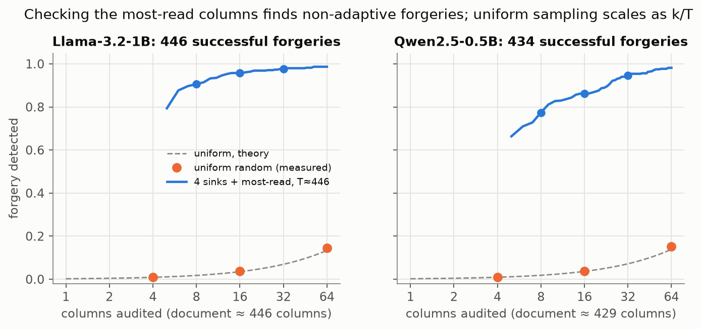

# kv-notary

**Can you trust a KV cache you did not compute?**

[](https://github.com/PS12007/kv-notary/actions/workflows/tests.yml)
· [interactive demo](https://ps12007.github.io/kv-notary/) · [paper (PDF)](docs/paper.pdf)

LLM serving now moves a transformer's KV cache between machines. Disaggregated serving ships it from prefill
GPUs to decode GPUs (DistServe, Splitwise, Mooncake). Prefix caches share it across requests (vLLM, SGLang).
Cache stores keep it on CPU, disk and remote storage (LMCache). Whichever node reads the cache trusts that it
encodes the tokens it came with. Nothing checks.

kv-notary shows that this trust is easy to abuse and cheap to verify.

| | Llama-3.2-1B | Qwen2.5-0.5B |
|---|---|---|
| one forged column (of ~440) flips the answer to the attacker's value | **86%** | **80%** |
| full check flags *only* the forged column | 99.8% | 98.6% |
| honest caches flagged (24 per model) | **0** | **0** |
| caught by checking the 8 most-read columns | **91%** | **77%** |
| caught by checking 32 most-read columns | 98% | 95% |
| caught by 64 *random* columns | 14% | 15% |

<p align="center"></p>

## The idea in three steps

1. **A cache is a function of its tokens.** Column *p* of an honest cache (token *p*'s keys and values at
   every layer) is what the model computes for token *p* while reading columns 0…p−1. By induction, a cache
   is honest if and only if every column agrees with that recomputation.
2. **Recomputing one column costs one token.** Run token *p* through the model against the *claimed*
   columns 0…p−1. Any set of columns is one batched pass. In bf16, compare to a per-layer tolerance
   calibrated on held-out documents.
3. **Check where the question reads.** A forged column only matters if the question reads it, and the
   reader computes that attention anyway. Score each column by value-weighted attention (a·‖v‖), check the
   4 attention sinks plus the top columns, and add random ones against attackers that spread out.

## What we found

- **One column is enough.** An untrusted prefill worker nudges the residual stream of *one* token at one
  layer, by at most that vector's own norm, and computes everything else honestly. That flips the answer
  at every depth, and on unrelated tokens almost as often as on the fact itself.
- **Forgeries are local; edits are loud.** A consistent forgery fails at exactly the forged column. An
  in-place edit of stored K/V breaks every later column that reads it, so even one random column usually
  catches it, except at the last layer.
- **Bit flips:** about 5% of random single-bit flips change the output. The harmful ones are almost all the
  top exponent bit, and a free range check catches every one of those.
- **The bf16 tolerance is a small but real hiding place.** Spreading a tiny nudge over every column
  usually fails or breaks hundreds of columns. But in 1 of 12 Qwen tasks it flipped the answer with every
  column inside tolerance, which no audit can catch. Closing that gap needs deterministic kernels, not a
  smarter audit (in fp32 the same attacks light up hundreds of columns).
- **Adaptive attackers win the deterministic part.** A white-box forger that knows the scoring rule can
  push its column out of the top 30 and still flip the answer in about half of the tasks. Different scores
  disagree about where it lands, so an ensemble helps, but only the random part of an audit gives a
  guarantee against this attacker. This is the main limitation, and the paper measures it in detail.
- **Cost:** at 16K tokens, the influence pass plus 16 audited columns take 6% of the prefill time on an RTX
  5060 Laptop GPU.

## Use it

```python
from kvnotary import Model, Notary

m = Model("llama-1b")                      # own Llama/Qwen2 forward; logits match transformers to 1e-4
notary = Notary(m, thresholds)             # per-layer bf16 tolerance (see experiments/common.py)
verdict = notary.audit(doc_ids, received_cache, question_ids, answer_ids)
print(verdict)   # REJECT (columns [212] disagree with their tokens); checked 28 columns in 41 ms
```

`python examples/demo.py` runs the whole story end to end: an honest cache, a forged one that changes the
answer, and the audit that rejects it.

## Reproduce

```bash
pip install -r requirements.txt
# models: unsloth/Llama-3.2-1B-Instruct and Qwen/Qwen2.5-0.5B-Instruct (HF snapshots, ~3.3 GB) in models/
python -m pytest tests                     # CPU, tiny random models, no downloads
bash run_all.sh                            # every experiment, one GPU job at a time (~8 h on 8 GB)
python experiments/figures.py && python experiments/paper.py
```

Every number in the paper and on the demo page is computed from `results/*.json` by `experiments/paper.py`.

## Layout

```
kvnotary/model.py     Llama / Qwen2 forward with residual and KV hooks, explicit attention for audits
kvnotary/verify.py    column recomputation, tolerance calibration, influence scores, audit plans
kvnotary/attacks.py   consistent forgery, in-place edit, bit flip, adaptive stealth forgery
kvnotary/notary.py    one-call audit API
experiments/          forge, corrupt, adaptive, innoise, cost, demo export, figures, paper
tests/                exactness tests on tiny random models (run in CI)
docs/                 GitHub Pages demo, figures, paper
```

## Limitations

Two small models, factual memo QA, documents up to ~2K tokens (a ~4K run did not fit next to other GPU
work on an 8 GB laptop card). The attacker knows the question in advance. The tolerance is calibrated on our
own kernels; heterogeneous prefill and decode hardware would need a looser one. The check proves a cache
matches its tokens and weights, not that the tokens are the right ones.

MIT licence.
